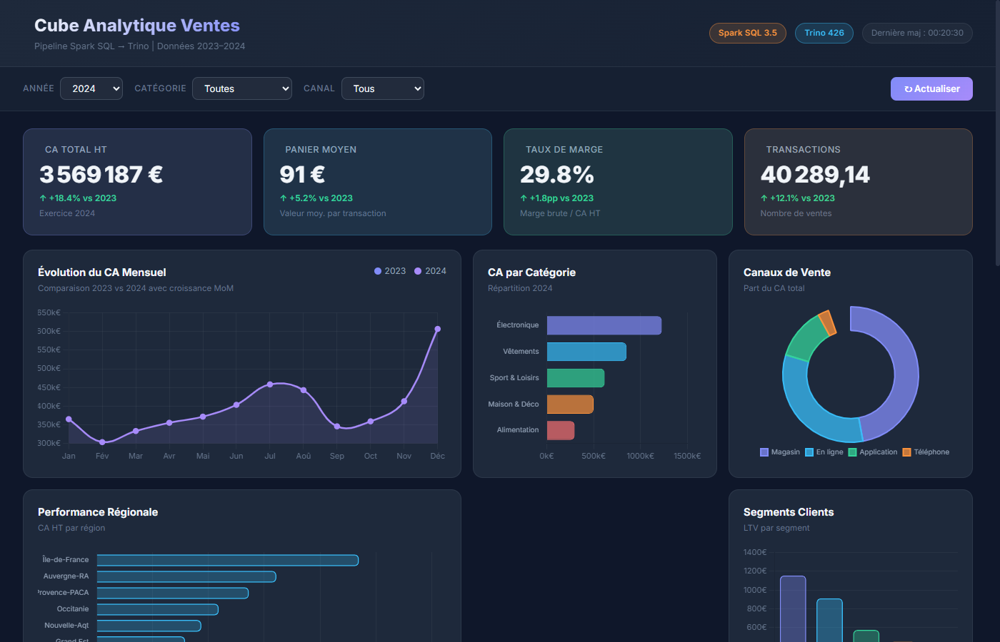
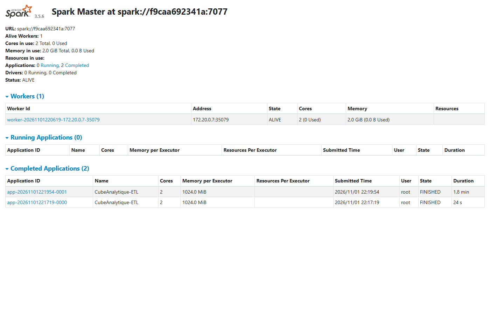
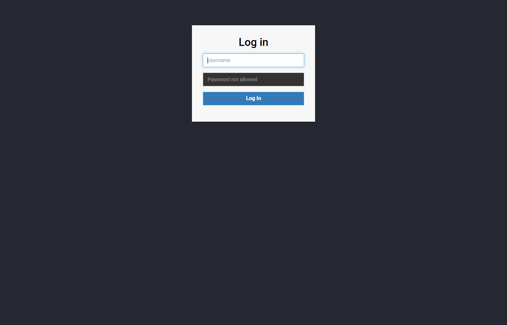

# Cube Analytique Ventes — Spark SQL + Trino

> Pipeline analytique complet : ETL Spark SQL → Cube OLAP Parquet → Requêtes Trino → Dashboard Web

---

## Aperçu et Screenshots

### Dashboard Analytique Interactif (http://localhost:8088)


### Spark Master Web UI (http://localhost:8080)


### Trino Web UI (http://localhost:8085)


---

## Structure du projet

```
cube-analytique/
├── docker-compose.yml          # Infrastructure complète (Spark, Trino, HMS, PostgreSQL, Dashboard)
├── data/
│   └── generate_data.py        # Générateur de données synthétiques (~500k transactions)
├── spark/
│   ├── spark-defaults.conf     # Configuration Spark (HMS + Hive Catalog)
│   └── jobs/
│       └── etl_pipeline.py     # Pipeline ETL + construction du cube OLAP
├── hive/
│   ├── hive-site.xml           # Configuration Hive Metastore
│   └── postgresql-42.6.0.jar   # Driver JDBC PostgreSQL compatible
├── trino/
│   ├── config.properties       # Configuration serveur Trino
│   ├── jvm.config              # Paramètres JVM Trino
│   ├── catalog/
│   │   └── hive.properties     # Connecteur Hive pour Trino
│   └── queries/
│       ├── 01_ca_mensuel.sql        # CA mensuel YoY/MoM/YTD
│       ├── 02_top_produits.sql      # Top 10 produits par CA
│       ├── 03_performance_region.sql # Performance régionale
│       ├── 04_segments_clients.sql   # Analyse RFM segments
│       └── 05_canal_saisonnalite.sql # Canal × saisonnalité
├── dashboard/
│   ├── index.html              # Dashboard analytique
│   ├── dashboard.css           # Design dark mode premium
│   └── dashboard.js            # Graphiques Chart.js + KPIs animés
└── docs/
    └── screenshots/            # Captures d'écran du projet
```

---

## Architecture

```
CSV bruts (local)
       │
       ▼
  ┌─────────────┐
  │  Spark SQL  │  ETL + schéma en étoile + cube OLAP
  └──────┼──────┘
         │  Parquet (volume Docker partagé)
         │  /opt/warehouse
         ▼
  ┌─────────────┐
  │     HMS     │  Catalogue partagé (tables + schémas)
  └──────┼──────┘
         │
         ▼
  ┌─────────────┐
  │    Trino    │  Requêtes analytiques rapides
  └──────┼──────┘
         │
         ▼
  Dashboard HTML (Chart.js)
```

> **Stockage simplifié** : les fichiers Parquet sont écrits dans un volume Docker partagé (`warehouse`) accessible par Spark, HMS et Trino. Aucun service de stockage objet nécessaire.

---

## Démarrage rapide

### Prérequis
- [Docker Desktop](https://www.docker.com/products/docker-desktop/) installé
- Python 3.8+ (pour la génération des données)
- 6 Go de RAM minimum alloués à Docker

### Étape 1 — Générer les données

```bash
cd cube-analytique
python data/generate_data.py
```

Cette commande crée les fichiers CSV dans `data/` :
- `dim_temps.csv` (730 jours)
- `dim_produit.csv` (500 produits)
- `dim_client.csv` (10 000 clients)
- `dim_magasin.csv` (50 magasins)
- `fact_ventes.csv` (500 000 transactions)

### Étape 2 — Démarrer l'infrastructure

```bash
docker-compose up -d
```

Attendez que tous les services soient `healthy` (~2-3 minutes) :

```bash
docker-compose ps
```

### Étape 3 — Exécuter le pipeline Spark ETL

> Les CSV dans `./data/` sont automatiquement montés dans le conteneur via le volume Docker (`./data:/opt/raw-data`).

```bash
docker exec spark-master spark-submit \
  --master spark://spark-master:7077 \
  /opt/spark-jobs/etl_pipeline.py
```

Le pipeline (~5-10 min) :
1. Lit les CSV bruts depuis `/opt/raw-data/`
2. Nettoie et valide les données
3. Écrit le schéma en étoile en Parquet partitionné
4. Enregistre les tables dans le Hive Metastore
5. Construit le cube OLAP (4 tables agrégées)
6. Affiche les KPIs de synthèse

---

### Alternative — Visualisation immédiate en local (sans Docker)

Si vous souhaitez calculer et visualiser immédiatement les résultats des KPIs sans démarrer le cluster Docker :

```bash
# Exécuter les calculs analytiques OLAP en direct sur les 500k lignes :
python tools/run_cube_analytics.py

# Ouvrir le dashboard interactif dans votre navigateur :
# Ouvrez simplement le fichier dashboard/index.html dans votre navigateur web
```

### Étape 4 — Requêtes Trino

```bash
# Se connecter à Trino
docker exec -it trino trino --server http://localhost:8080

# Dans le shell Trino :
USE hive.ventes_dw;
SHOW TABLES;

-- Lancer une analyse
SELECT annee, ROUND(SUM(ca_ht)/1e6, 2) AS ca_millions
FROM cube_mensuel_categorie
GROUP BY annee ORDER BY annee;
```

Ou exécuter les fichiers SQL :
```bash
docker exec trino trino --server http://localhost:8080 \
  -f /etc/trino/queries/01_ca_mensuel.sql
```

---

## Interfaces web

| Service | URL | Credentials |
|---------|-----|-------------|
| **Dashboard Analytics** | http://localhost:8088 | — |
| **Spark Master UI**     | http://localhost:8080 | — |
| **Trino Web UI**        | http://localhost:8085 | admin / (vide) |

---

## Modèle de données

### Tables de faits
| Table | Lignes | Description |
|-------|--------|-------------|
| `fact_ventes` | 500 000 | Transactions de vente partitionnées par année/mois |

### Dimensions
| Table | Lignes | Description |
|-------|--------|-------------|
| `dim_temps` | 730 | Calendrier 2023-2024 avec saisons, trimestres |
| `dim_produit` | 500 | Produits par catégorie et sous-catégorie |
| `dim_client` | 10 000 | Clients par segment, région, âge |
| `dim_magasin` | 50 | Magasins par type, ville, région |

### Cube OLAP (tables agrégées)
| Table | Description |
|-------|-------------|
| `cube_mensuel_categorie` | CA + marge par mois × catégorie |
| `cube_mensuel_region` | CA + clients par mois × région |
| `cube_mensuel_canal` | CA par mois × canal de vente |
| `cube_produit_top` | Classement annuel des produits |

---

## KPIs disponibles

- **CA mensuel** avec croissance MoM, YoY et cumul YTD
- **Top 10 produits** par CA avec part de marché par catégorie
- **Performance régionale** avec rang et part du CA national
- **Segments clients** (LTV, fréquence d'achat, panier moyen)
- **Canaux de vente** (Magasin, En ligne, Application, Téléphone)
- **Saisonnalité** (pics décembre, été, soldes janvier)

---

## Arrêter l'infrastructure

```bash
docker-compose down          # Arrêter (données conservées)
docker-compose down -v       # Arrêter + supprimer les volumes
```

---

## Dépannage

**Hive Metastore ne démarre pas :**
```bash
docker logs hive-metastore
# Vérifier que PostgreSQL est healthy
docker-compose ps postgres
```

**Spark ne voit pas les tables Hive :**
```bash
# Vérifier la connexion au metastore
docker exec spark-master spark-submit --master local \
  --conf spark.sql.catalogImplementation=hive \
  --conf spark.hadoop.hive.metastore.uris=thrift://hive-metastore:9083 \
  /opt/spark-jobs/etl_pipeline.py
```

**Trino — erreur de connectivité :**
```bash
docker logs trino | tail -50
# Vérifier le catalogue
curl http://localhost:8085/v1/info
```
